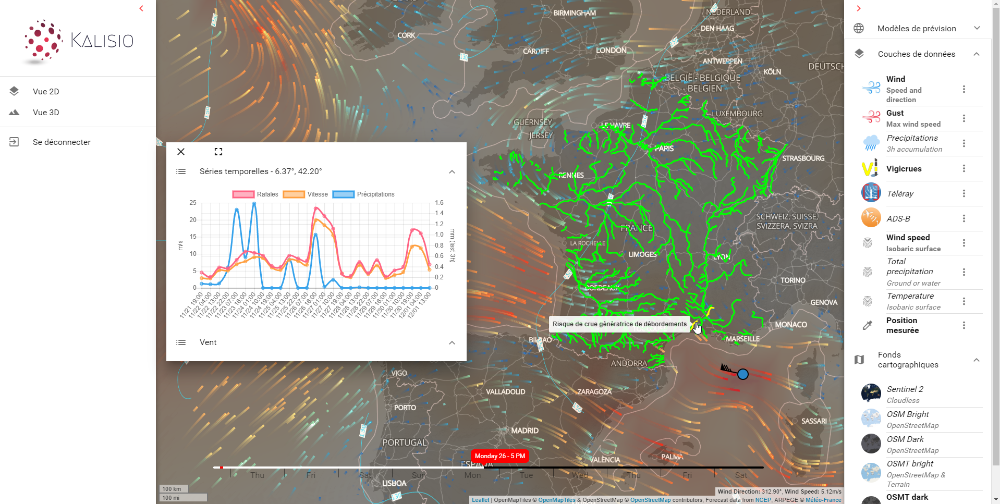

# kano

Kano is a client aplication that can be used to visualise geospatial data served by [Kargo](https://kalisio.github.io/kargo/).

> This application is based on the [Kalisio Development Kit](https://kalisio.github.io/kdk/).

## Documentation

Full documentation is available [here](https://kalisio.github.io/kano/)

## License

Licensed under the [MIT license](LICENSE).

The detailed list of Open Source dependencies can be found in our [3rd-party software report](https://app.fossa.com/reports/f97aacf2-aee3-4582-b99f-fdac4d2ba331).

Copyright (c) 2026-present [Kalisio](https://kalisio.com)

<a href="https://kalisio.com">
  <picture>
    <source media="(prefers-color-scheme: dark)" srcset="https://kalisio.github.io/kalisioscope/kalisio/kalisio-logo-dark.svg">
    <source media="(prefers-color-scheme: light)" srcset="https://kalisio.github.io/kalisioscope/kalisio/kalisio-logo-light.svg">
    
  </picture>
</a>

